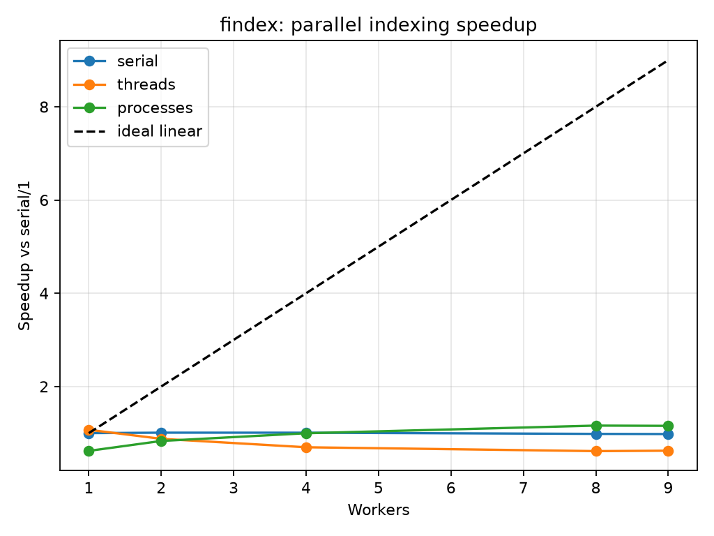
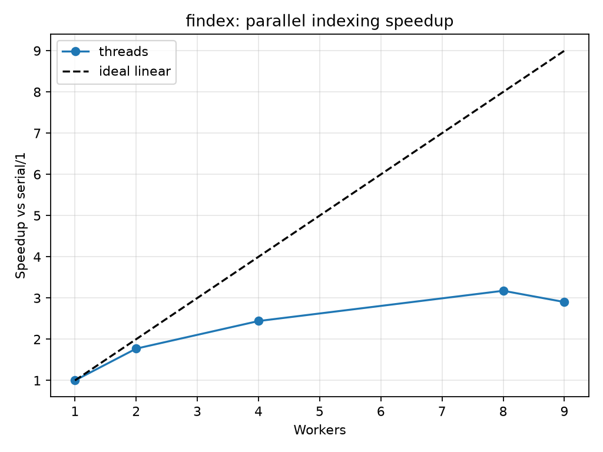

# findex — Python, лабораторні роботи №1–5

[](https://github.com/LeVanchua/findex/actions/workflows/ci.yml)

## Лабораторна №5 — конкурентність, GIL і паралельна індексація

Той самий корпус: **1000 локальних синтетичних українських документів**, згенерований у ЛР №1 (`python -m findex.cli generate --count 1000 --repetitions 20`).

```bash
uv sync
uv run findex index data/ --out index.bin --executor serial --workers 1
uv run findex index data/ --out index.bin --executor threads --workers 4
uv run findex index data/ --out index.bin --executor processes --workers 8
uv run findex search index.bin 'генератори OR індекс' --top 5
uv run python bench_lab05.py data/ --repetitions 3
uv python install 3.13t
uv run python bench_lab05.py data/ --repetitions 3 --only-executor threads --python /path/to/python3.13t --output benchmark_lab05_313t.json
```

Замість `/path/to/python3.13t` потрібно вказати шлях із `uv python find 3.13t`. У цьому досліді для другої команди встановлено Python **3.13.18+freethreaded**. Запуск окремим інтерпретатором не змінює віртуальне середовище проєкту. `--executor processes` тепер типовий, з `min(8, os.cpu_count())` воркерами: на цьому корпусі 8 процесів дали найменший час серед звичайних режимів.

### Реалізація та перевірки

- `src/findex/parallel.py`: `build_partial(root, paths, start_id, with_positions)` — функція верхнього рівня, якій передаються **відносні шляхи**, а не прочитані тексти. `start_id` гарантує унікальний діапазон ID для кожного шматка. `merge(parts)` відсортовує постінги та відхиляє повторні ID.
- `build_parallel` застосовує одну й ту саму функцію воркера у serial, `ThreadPoolExecutor`, `ProcessPoolExecutor`; процеси запускаються з `mp_context=get_context('spawn')`. Винятки передаються через `future.result()` з оригінальним traceback, без зависання.
- Тести `tests/test_parallel.py`: повна відповідність `merge([build_partial(усі_шляхи)])` індексу ЛР №4 з позиціями й без них; однаковість трьох executor для 1/2/4/8 воркерів; перевірка дубльованих ID, винятку процесу та CLI.

### Реальні вимірювання (Linux, CPython 3.12.14, GIL увімкнено)

CPU: **AMD EPYC 9V74 80-Core Processor**; середовищу доступно **9 логічних CPU** (`os.cpu_count() = 9`), що є значенням останньої конфігурації. У кожній клітинці **медіана трьох незалежних запусків у новому інтерпретаторі**. `wall` — секунд за годинником, `CPU` — сума user+system CPU часу батька та завершених дочірніх процесів, `RSS` — пік пам'яті **тільки батьківського процесу** (не сумарне RSS воркерів), `merge` — час збирання частин у батька. `speedup = median(serial,1) / median(режим,N)`; базовий час — 0.245 с.

| Executor | Workers | Wall, с | CPU, с | Parent RSS, MiB | Merge, с | Speedup |
|---|---:|---:|---:|---:|---:|---:|
| serial | 1 | 0.245 | 0.245 | 16.875 | 0.002 | 1.000 |
| serial | 2 | 0.243 | 0.243 | 17.000 | 0.002 | 1.010 |
| serial | 4 | 0.243 | 0.243 | 17.000 | 0.002 | 1.009 |
| serial | 8 | 0.249 | 0.249 | 17.125 | 0.002 | 0.984 |
| serial | 9 | 0.250 | 0.250 | 17.125 | 0.002 | 0.980 |
| threads | 1 | 0.229 | 0.229 | 17.125 | 0.002 | 1.072 |
| threads | 2 | 0.279 | 0.284 | 17.125 | 0.002 | 0.878 |
| threads | 4 | 0.352 | 0.383 | 17.250 | 0.002 | 0.697 |
| threads | 8 | 0.399 | 0.456 | 17.375 | 0.003 | 0.614 |
| threads | 9 | 0.394 | 0.446 | 17.500 | 0.002 | 0.623 |
| processes | 1 | 0.396 | 0.398 | 20.875 | 0.002 | 0.619 |
| processes | 2 | 0.295 | 0.530 | 19.543 | 0.003 | 0.832 |
| processes | 4 | 0.246 | 0.767 | 18.750 | 0.002 | 0.997 |
| processes | 8 | 0.211 | 1.259 | 18.375 | 0.002 | 1.161 |
| processes | 9 | 0.212 | 1.307 | 18.375 | 0.002 | 1.156 |



Точні неокруглені значення: [`benchmark_lab05.json`](benchmark_lab05.json). На цьому **невеликому** корпусі перевага процесів скромна (максимум 1.16×), а один процес повільніший за послідовний цикл через запуск `spawn` і pickle. Не можна стверджувати, що процеси завжди швидші: результати залежать від корпуса, обладнання та навантаження.

### Python 3.13t: потоки без GIL

`sys._is_gil_enabled()` у Python 3.12.14 → `True`; у **Python 3.13.18+freethreaded** → **`False`**, фактично перевірено. Той самий корпус, код та три повторення:

| Threads (Python 3.13t) | Wall, с | Speedup відносно 3.13t / 1 потік |
|---:|---:|---:|
| 1 | 0.307 | 1.00 |
| 2 | 0.173 | 1.77 |
| 4 | 0.126 | 2.44 |
| 8 | 0.097 | 3.18 |
| 9 | 0.106 | 2.90 |



Сирі числа: [`benchmark_lab05_313t.json`](benchmark_lab05_313t.json). Це інша версія Python, тому пряме порівняння абсолютного часу з 3.12 змішує вплив GIL та змін інтерпретатора; показник speedup порівнює конфігурації **в межах того самого** 3.13t.

### Рефлексія: GIL, гонитви, накладні витрати та закон Амдала

Повний текст власними словами: [GIL_LAB05.md](GIL_LAB05.md).

**Здача:** оновити файли в цьому самому репозиторії та створити тег `lab-05` після зеленого CI. Дані і графіки вже отримані експериментально; для іншої машини потрібно повторити `bench_lab05.py`.

---

## Лабораторна №4 — типи, тести, пакування та CLI

Версія **0.4.0** перетворює `findex` на встановлюваний Python-пакет зі зручними командами Typer/Rich. Усі попередні алгоритми, індекс, ранжування та тести з ЛР №1–3 збережено. Python 3.11+.

### Встановлення та запуск

```bash
uv sync
uv run findex --help
uv run python -m findex.cli generate --count 1000 --repetitions 20
uv run findex index data/ --out index.bin --positions
uv run findex search index.bin 'python OR "пошукова система"' --corpus data/ --top 5
uv run findex search index.bin 'python OR сервер' --json > results.json
uv run findex stats data/
```

Для постійного встановлення команди в PATH (без переходу до каталогу проєкту):

```bash
uv tool install .
findex --help
```

Пакет із файлу релізу також можна встановити у чисте середовище:

```bash
uv venv clean-env
uv pip install --python clean-env dist/findex-0.4.0-py3-none-any.whl
```

На Windows шлях до виконуваного файлу — `clean-env\Scripts\findex.exe`; у Linux/macOS — `clean-env/bin/findex`. Wheel `findex-0.4.0-py3-none-any.whl` збирається командою `uv build` і прикріплюється до релізу `v0.4.0` на GitHub.

### Основні вимоги реалізації

| Компонент | Реалізація |
|---|---|
| Типізація | У `src/findex` анотовано функції, генератори як `Iterator`, тип `Scorer` описаний `typing.Protocol`; `pyright` працює в `strict` |
| Публічні команди | `findex index`, `findex search`, `findex stats` |
| Інтерфейс | `typer` + `rich` (прогрес побудови, таблиці, повідомлення про помилки) |
| Формат для програм | `findex search --json`: чистий JSON у stdout, діагностика у stderr |
| Логування | `-v` (INFO) / `-vv` (DEBUG), логер налаштовується один раз у Typer callback |
| Некоректний запит/відсутній файл | Одне повідомлення `Error: ...`, ненульовий код завершення, без traceback |
| Тести | pytest, параметризація, `conftest.py`, `CliRunner`, три властивості Hypothesis |
| Автоматизація | `.github/workflows/ci.yml`: push/PR → uv sync → ruff → pyright → pytest |

### Справжні результати перевірок

Виміряно локально на Linux із CPython 3.12.14:

```text
uv run ruff check .
All checks passed!

uv run pyright
0 errors, 0 warnings, 0 informations

uv run pytest -q --cov=findex --cov-report=term-missing
54 passed in 1.42s
TOTAL 861 statements, 277 missed, coverage 68%
```

**Що навмисно не охоплено тестами:** старі окремі скрипти-CLI з ЛР №1–3 (`cli.py`, `index.py`, `search.py`, `ranked_cli.py`), скрипти бенчмарків (`benchmark.py`, `evaluation.py`) та генератор демонстраційного корпусу (`sample_data.py`) використовуються для ручних сценаріїв. Нова інсталяційна CLI тестується автоматично через `typer.testing.CliRunner`. Для критичної логіки індексу, парсера і ранжування покриття суттєво вище загального. Показник 68% — фактичний, а не бажаний. `@pytest.mark.slow` зареєстровано в `pyproject.toml`; у поточному наборі немає окремих тестів тривалістю більше секунди.

**Hypothesis:** мінімум три перевірки на згенерованих даних: `load(save(index)) == index`, строгий порядок ID у постінгах та еквівалентність `merge` із множинними операціями. Тимчасові корпуси ізольовано створюються для кожного згенерованого прикладу.

### Відповіді на Reflection

1. **Навіщо strict типізація?** Вона виявляє несумісності у всіх гілках обчислень до запуску, а `Protocol` дозволяє підміняти TF-IDF і BM25 без наслідування.
2. **Чому Hypothesis не замінює pytest?** Властивості перевіряють загальні інваріанти на багатьох входах; прикладні тести фіксують конкретну поведінку й повідомлення CLI.
3. **Навіщо wheel?** Це стандартний готовий до встановлення Python-пакет, який не вимагає запуску коду з папки репозиторію.
4. **Навіщо `stderr` і `stdout` розділені?** Щоб дані `--json` можна було перенаправити у файл без домішок логів.
5. **Навіщо CI?** Кожен push і PR автоматично перевіряються на стиль, типи та регресії; бейдж з'явиться зеленим лише після успішного запуску GitHub Actions.

**Здача ЛР №4:** у тому самому репозиторії оновити всі файли з цього архіву, додати `.github/workflows/ci.yml`, зробити коміт, створити тег `lab-04`, а також окремий реліз із тегом `v0.4.0`, до якого вручну прикріпити wheel із папки `dist/`. До успішного завершення GitHub Actions не слід заявляти, що CI на GitHub пройшов.

---

## Лабораторні №1–3 — попередня функціональність

## Лабораторна №3 — рейтинг і модель об'єктів

Третя лабораторна продовжує той самий корпус та інвертований індекс. Додано об'єкт `Index` з протоколом `Mapping`, методами `len(index)`, `term in index`, `index[term]`, `iter(index)`, `repr(index)`, властивостями `num_docs`, `@cached_property avg_doc_length`, `df(term)` та контекстним менеджером `with open_index(...)`. `close()` очищає кеш навіть за винятку. ЛР №1–2 та їхні CLI-команди залишаються працездатними.

### Запуск ЛР №3

```bash
uv sync
uv run findex generate --count 1000 --repetitions 20
uv run pytest -q
uv run python -m findex.index data/ --out index.bin --positions
uv run python -m findex.ranked_cli index.bin 'python OR "пошукова система"' --scorer bm25 --top 5 --repeat
uv run python -m findex.ranked_cli index.bin 'python AND (генератори OR алгоритм)' --scorer tfidf --top 5
uv run python -m findex.evaluation data/
```

Синтаксис складного запиту демонструється також командою:

```bash
uv run python -m findex.ranked_cli index.bin 'python AND (async OR await) NOT java "event loop"'
```

На демонстраційному корпусі такий запит може дати нуль результатів — він перевіряє саме парсер; для ненульового результату є приклад з `"пошукова система"`. Точні фрази вимагають індексу, побудованого з `--positions`. Без цього прапорця програма видає зрозумілу помилку.

### Модель об'єктів і парсер

- `model.py` — `Index(Mapping)`, `load_model`, `open_index`, LRU-кеш документа IDs.
- `query.py` — рекурсивний спуск, незмінні AST-вузли `Term`, `Phrase`, `And`, `Or`, `Not`; оператори `&`, `|`, `~`. Пріоритет: `NOT` > `AND` > `OR`; сусідні елементи означають `AND`; дужки й фрази у подвійних лапках підтримуються.
- `ranking.py` — протокол `Scorer`, взаємозамінні `TfIdf` і `BM25(k1=1.5, b=0.75)`, результати `SearchResult(order=True)`, вибір топ-k через `heapq.nlargest`, підсвічені Markdown-маркерами сніпети у вікні ±80 символів.
- `timing.py` — декоратор `@timed` із `functools.wraps` для побудови індексу, завантаження й ранжованого пошуку; логи через стандартний `logging`.
- `evaluation.py` — 10 заздалегідь анотованих тематичних запитів і `precision@5`.

Типова програма з контекстним менеджером:

```python
from findex.model import open_index
from findex.ranking import BM25, ranked_search

with open_index("index.bin") as index:
    print(len(index), "python" in index, index.df("python"))
    results = ranked_search(index, 'python OR "пошукова система"', BM25(), 5, "data")
    for result in results:
        print(result.title, result.score, result.snippet)
```

### Три sanity-check рейтингу (реальні обчислення)

Параметри: BM25 `k1=1.5`, `b=0.75`; N=1000 документів, середня довжина 358 токенів. Значення показують окремий внесок одного терміна у бал, інші умови однакові.

| Експеримент | Налаштування | TF-IDF | BM25 |
|---|---|---:|---:|
| Рідкісний термін | df=100, tf=1, довжина=358 | 3.29363 | 2.29860 |
| Дуже частий термін | df=1000, tf=1, довжина=358 | 1.00000 | 0.00050 |
| 19 повторень | df=100, довжина=358 | — | 5.32602 |
| 20 повторень | df=100, довжина=358 | — | 5.34557 |
| Короткий документ | df=100, tf=1, довжина=100 | — | 3.40181 |
| Дуже довгий документ | df=100, tf=1, довжина=2000 | — | 0.75020 |

**Висновки:** рідкісне слово важить більше за поширене; 20-те повторення додає лише **0.01956** бала, хоча перше давало 2.29860; короткий документ за одного входження отримує вищий BM25, ніж дуже довгий. Для математичної чистоти в цій таблиці оцінюються контрольовані параметри на основі статистики нашого корпусу; це не твердження, що всі шість комбінацій є окремими реальними документами.

### Precision@5 — десять анотованих запитів

Корпус синтетичний і має 10 явно відомих тематичних шаблонів. Релевантність призначалася **до виконання пошуку** за змістом цих шаблонів: кожен із 100 документів відповідної теми вважається релевантним запиту. `evaluation.py` зберігає ручні тематичні мітки та розгортає їх у doc_id відповідно до детермінованого генератора. Кожен пропущений слот у топ-5 враховується як нерелевантний.

| Запит | Тема, яку вважаємо релевантною | TF-IDF P@5 | BM25 P@5 |
|---|---|---:|---:|
| генератори | Python та ітератори | 1.00 | 1.00 |
| sql | Бази даних | 1.00 | 1.00 |
| тестування | Тести | 1.00 | 1.00 |
| протокол | Мережі | 1.00 | 1.00 |
| навчання | Машинне навчання | 1.00 | 1.00 |
| алгоритм | Алгоритми | 1.00 | 1.00 |
| вебзастосунок | Вебтехнології | 1.00 | 1.00 |
| git | Контроль версій | 1.00 | 1.00 |
| unicode | Обробка Unicode | 1.00 | 1.00 |
| корпус | Пошукова система | 1.00 | 1.00 |
| **Середнє** | | **1.00** | **1.00** |

Це реально отримані значення `uv run python -m findex.evaluation data/`. Обидві моделі досягли максимуму, тому **цей простий штучний корпус не дає підстав робити висновок про перевагу однієї моделі**. Для серйозного порівняння потрібні складніші неоднозначні запити та незалежна розмітка справжніх текстів.

### Вимірювання @timed і LRU-cache

Наведений нижче фрагмент зафіксовано на корпусі з 1000 документів. Команда виконує ідентичний запит двічі в межах одного `with open_index(...)`:

```text
@timed load_model 0.028659 s
query cache MISS: 'python OR "пошукова система"'
@timed ranked_search 0.019213 s
query cache HIT: 'python OR "пошукова система"'
@timed ranked_search 0.017611 s
```

Кешується **запит → кортеж ID знайдених документів**, але бал і сніпети обчислюються знову, тому весь `ranked_search` не прискорюється радикально. `@lru_cache(maxsize=512)` використовує сам об'єкт `Index` як частину ключа, що ізолює кеш різних індексів; `close()` очищає його. `@timed` зберігає метадані функції завдяки `wraps`.

### Reflection — відповіді

1. **Для чого dunder-методи?** Дають змогу працювати з класом через звичайний синтаксис Python: `len`, `in`, `[]`, `for`, `repr`.
2. **Що таке протокол і duck typing?** `Scorer` задає потрібний метод `score`, а реалізації TF-IDF і BM25 можуть використовуватися взаємозамінно без спільного базового класу.
3. **Що робить `cached_property`?** Рахує середню довжину один раз і зберігає результат до закриття індексу.
4. **Чому BM25 насичує TF?** Член `tf(k1+1)/(tf + k1*normalization)` має обмежену верхню межу, тому зайві повторення мало допомагають.
5. **Чому фраза потребує позицій?** Однакові слова в документі ще не гарантують, що вони стоять поспіль у потрібному порядку.
6. **Навіщо `heapq.nlargest`?** Вибирає найкращі k результатів без повного сортування всього списку; зручно за малого k.
7. **Навіщо контекстний менеджер?** Гарантує виклик `close()`, зокрема в разі винятку, й очищення кешу.
8. **Навіщо декоратор та кеш?** `@timed` відокремлює профілювання від алгоритму, `lru_cache` повторно використовує готову множину відповідних ID.

**Здача ЛР №3:** оновіть той самий публічний GitHub-репозиторій і створіть тег `lab-03` після коміту нових файлів та README; попередні теги не змінюйте. Каталог `data/` і файли індексу зберігаються локально згідно з `.gitignore`.

---

## Лабораторні №1–2 — попередня функціональність

Пошукова система для україномовних текстів. Проєкт продовжує ЛР №1: ліниве читання файлів, Unicode-токенізатор і статистика корпусу. ЛР №2 додає інвертований індекс, Boolean-пошук, серіалізацію та порівняння структур даних.

## Швидкий старт

Встановіть Python 3.11+ та [uv](https://docs.astral.sh/uv/), відкрийте термінал у папці проєкту:

```bash
uv sync
uv run findex generate --count 1000 --repetitions 20
uv run pytest -q
uv run python -m findex.index data/ --out index.bin
uv run python -m findex.search index.bin "python OR сервер" --engine merge
uv run python -m findex.search index.bin "python NOT сервер" --engine set
uv run python -m findex.benchmark data/
```

Корпус `data/` є синтетичним, складається з 1000 локально згенерованих текстів про IT і не включається в Git. Можна замінити його власними UTF-8 `.txt` файлами. Існуюча функціональність ЛР №1 збережена: `uv run findex benchmark` показує статистику текстів та порівняння потокової й жадібної обробки.

## Як працює індекс

`iter_documents()` читає файли по одному. `tokenize()` нормалізує Unicode NFKC + casefold, зводить апострофи до `'`, розділяє дефіси, зберігає цифри. `build_index()` за **один прохід** створює `term -> list[Posting(doc_id, frequency)]` за допомогою `defaultdict`. Списки відсортовано за `doc_id`, оскільки документи обходяться в порядку зростання ID. `DocMeta` зберігає ID, відносний шлях, назву та кількість токенів. `Posting` і `DocMeta` — незмінні `@dataclass(frozen=True, slots=True)`.

Правила Boolean-запитів: `NOT` має найвищий пріоритет, далі `AND`, потім `OR`; дужки змінюють порядок. Два слова поруч означають `AND` (наприклад, `python сервер`). `python NOT сервер` тлумачиться як `python AND NOT сервер`. Незнайомий термін повертає порожній список.

- `--engine merge`: перетин двома вказівниками по відсортованих ID; об'єднання та доповнення теж реалізовані відсортованими обходами.
- `--engine set`: операції `&`, `|`, `-` над множинами, потім сортування результатів.
- `--positions`: опційно записує позиції токенів у документах, збільшуючи розмір індексу.

## Збереження

```bash
uv run python -m findex.index data/ --out index.bin --format pickle
uv run python -m findex.search index.bin "python AND сервер" --format pickle
uv run python -m findex.index data/ --out index.json --format json
uv run python -m findex.search index.json "python OR сервер" --format json --engine set
```

**Безпека:** `pickle.load()` може виконувати довільний код під час десеріалізації. Не завантажуйте чужі, неперевірені `.bin`/`.pickle` файли. JSON — текстовий формат даних, який не виконує Python-код, але все одно потребує перевірки структури і розміру файлу. Обидва CLI-виклики виводять час виконання та пікову пам'ять Python через `tracemalloc`.

## Вимірювання

Далі — **реальні вимірювання**, а не приклади: Linux, CPython 3.12.14, синтетичний корпус 1000 документів (20 повторів тексту на файл), 358 000 токенів і 1106 унікальних термів. Вимірювання виконано одним запуском `uv run python -m findex.benchmark data/ --repetitions 100`. `tracemalloc` показує пам'ять, виділену Python, **не** повний RSS процесу. Час залежить від комп'ютера і фонових процесів.

### 1. Три способи зберігання постінгів

У кожному випадку створено рівно **17 900 пар (doc_id, frequency)** за одним і тим самим корпусом. Для чистоти порівняння вимірюється структура словника постінгів, без метаданих документів; дані залишаються в пам'яті до завершення вимірювання піку.

| Представлення | Час побудови, с | Пікова Python-пам'ять, MiB |
|---|---:|---:|
| Звичайний `@dataclass` | 0.7860 | 1.841 |
| `@dataclass(slots=True)` | 0.7161 | 1.278 |
| Два масиви `array('I')` | 0.7037 | 0.576 |

**Куди йдуть байти:** звичайний об'єкт зберігає окремий словник атрибутів `__dict__` і має накладні витрати на кожен із 17 900 записів. `slots=True` усуває словники екземплярів. Два `array('I')` зберігають doc ID і частоти як упаковані 32-бітні беззнакові числа замість тисяч окремих об'єктів; це найкомпактніше представлення в експерименті. Воно обмежує значення діапазоном `0..2^32-1`. Всі три реалізації використовують `defaultdict` як мапу термів.

### 2. Boolean-пошук: merge проти set

Показано **медіану 100 викликів** для кожної комбінації. Індекс уже завантажений у пам'ять, тому серіалізація не впливає на час запиту. Найчастіші терміни: `документ`, `тема` (по 20 000 входжень); найрідкісніші: `1`, `10` (по 20 входжень, номери синтетичних документів). В обох випадках два терміни без оператора означають `AND`.

| Пара | Запит | Збігів | Merge, мс | Set, мс |
|---|---|---:|---:|---:|
| Найчастіші | `документ тема` | 1000 | 0.14186 | 0.07360 |
| Найрідкісніші | `1 10` | 0 | 0.01135 | 0.01142 |

**Пояснення:** для частих слів множини в цьому запуску швидші, бо операції `set` виконуються оптимізованим кодом Python. Для коротких рідкісних списків різниця практично відсутня; результат `0` означає, що різні номери документа не зустрілися разом. Теоретична вартість merge-перетину — O(n + m) за вже відсортованими списками; підхід `set` потребує додаткової пам'яті для множин і сортування результату. Для надійних висновків варто повторити експеримент на реальному корпусі кілька разів.

### 3. Збереження/завантаження

| Формат | Розмір файлу, байт | Save, с | Load, с | Пік save, MiB | Пік load, MiB |
|---|---:|---:|---:|---:|---:|
| Pickle | 324 724 | 0.1213 | 0.1359 | 3.832 | 4.617 |
| JSON | 212 954 | 0.0915 | 0.0737 | 2.645 | 3.597 |

На цьому корпусі JSON виявився меншим і швидшим, але це не універсальне правило. Час включає серіалізацію та операції з файлом, а не побудову самого індексу. Збережені індекси були завантажені назад і всі постінги порівняні з початковими. Повний виклик `python -m findex.index data/ --out index.bin` показав 1.1181 с і пік 5.236 MiB, пошук із завантаженням файлу `python OR сервер` — 0.1426 с, 4.725 MiB і 300 збігів.

### 4. Ціна позицій токенів

| Налаштування | Розмір Pickle, байт |
|---|---:|
| Без `--positions` | 324 724 |
| З `--positions` | 1 272 558 |

Включення позицій збільшує файл на **291.9%**, бо крім частот зберігаються всі зміщення токенів для кожної пари термін–документ. Для поточного Boolean-пошуку вони не потрібні, але можуть стати основою пошуку фраз у наступних лабораторних.

## Структура проєкту

```text
findex/
├── src/findex/
│   ├── corpus.py          # ЛР1: генератор документів
│   ├── tokenizer.py       # ЛР1: Unicode-токенізатор
│   ├── stats.py           # ЛР1: статистика
│   ├── cli.py             # ЛР1: генерація корпусу, профілювання
│   ├── sample_data.py     # відтворюваний корпус
│   ├── inverted.py        # ЛР2: індекс, Posting, DocMeta, три представлення
│   ├── boolean.py         # ЛР2: AND/OR/NOT, merge/set
│   ├── serialization.py   # ЛР2: pickle/JSON
│   ├── profiling.py       # ЛР2: час і tracemalloc
│   ├── index.py           # ЛР2: CLI побудови
│   ├── search.py          # ЛР2: CLI пошуку
│   └── benchmark.py       # ЛР2: реальні порівняння
├── tests/                 # тести ЛР1 і ЛР2
├── pyproject.toml
├── uv.lock
├── .gitignore             # data/, .venv/, кеш і індекси
└── README.md
```

## Reflection — підготовка до 5-хвилинного захисту

1. **Що таке інвертований індекс?** Словник, де кожному терміну відповідають ідентифікатори документів і частоти входження. Замість сканування всього корпусу пошук читає лише потрібні списки постінгів.
2. **Навіщо `__hash__` та `__eq__`?** `dict`/`set` використовують хеш для швидкого знаходження ключа, а рівність — для перевірки можливих збігів. Якщо два об'єкти рівні, їхні хеші обов'язково мають бути однаковими. `frozen=True` підтримує незмінність значень ключів, а `slots=True` економить пам'ять.
3. **Чому `defaultdict`?** Автоматично створює порожній список для нового терміна, тому не потрібна перевірка `if term not in index` перед кожним додаванням. `Counter` рахує частоти термів у межах одного документа.
4. **У чому різниця merge і set?** Merge одночасно проходить по двох відсортованих списках; set виконує операції над хеш-таблицями, але створює додаткові множини. Швидкість залежить від довжини списків та реалізації.
5. **Навіщо `slots=True` та `array('I')`?** `slots` прибирає словник атрибутів на кожному об'єкті. `array('I')` щільно розміщує однотипні цілі числа без окремого Python-об'єкта для кожного значення.
6. **Чому pickle небезпечний?** При завантаженні стороннього файлу pickle може виконати шкідливий код. JSON безпечніший щодо виконання коду, бо містить лише дані.
7. **Навіщо два формати?** Щоб порівняти швидкість, переносимість, розмір та властивості безпеки, а також перевірити повне відновлення структури.
8. **Як довести однопрохідність?** Кожен документ надходить лише один раз через `iter_documents`; `Counter` обробляє його токени, після чого дані додаються до глобального індексу. Для пошуку готовий індекс завантажується з диска без повторного обходу текстів.

## Як здати

У тому самому публічному репозиторії GitHub замініть/додайте файли з цього архіву, створіть новий коміт, а потім тег **`lab-02`** на поточній гілці `main` (можна через **Releases → Draft a new release**). **Не змінюйте тег `lab-01`:** він має залишатися на попередній версії. Перевірте, що `data/` не завантажено. Викладачу надішліть посилання на репозиторій та, за потреби, на `/releases/tag/lab-02`.
